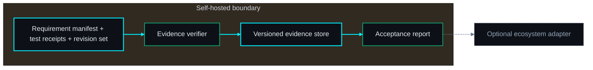
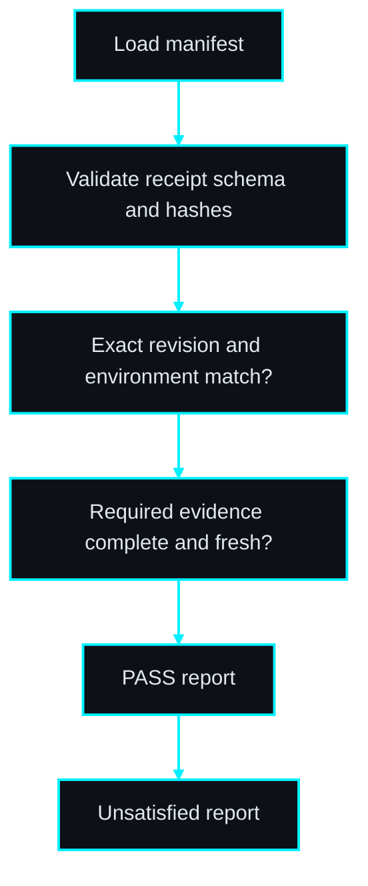
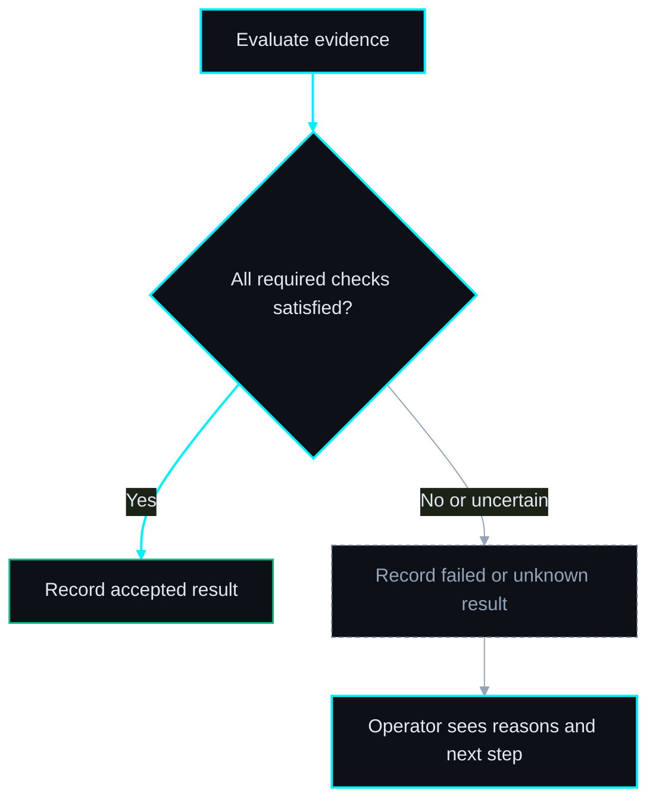

# ProofGate diagram pack

Status: proposed topology for autonomous PRD drafting; not approved for implementation.

#### ◇ Diagram — Architecture
*The core works independently; adapters are optional.*

> **THE POINT:** The core works independently; adapters are optional.

#### ◇ Diagram — Workflow
*Persist evidence at each boundary; unresolved outcomes remain visible.*

> **THE POINT:** Persist evidence at each boundary; unresolved outcomes remain visible.

#### ◇ Diagram — Acceptance decision
*Completion and acceptance are separate; uncertainty cannot become success.*

> **THE POINT:** Completion and acceptance are separate; uncertainty cannot become success.

## Proposed decisions

Choose trusted receipt producers and signing policy for the pilot; decide whether branch-protection integration belongs after MVP.

## Risk flags

A forged trusted-runner receipt remains possible without attestation. MVP verifies consistency and declared provenance, not honesty of arbitrary test producers.
